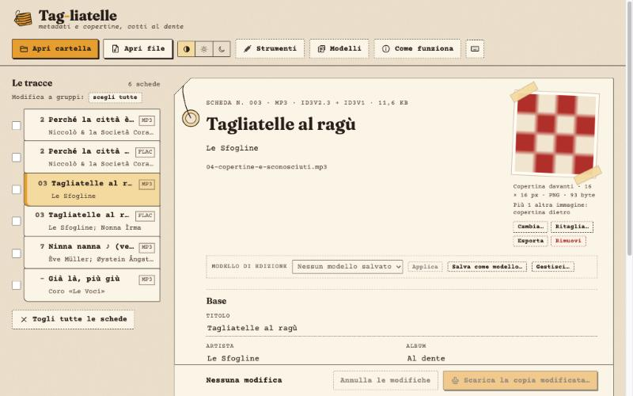
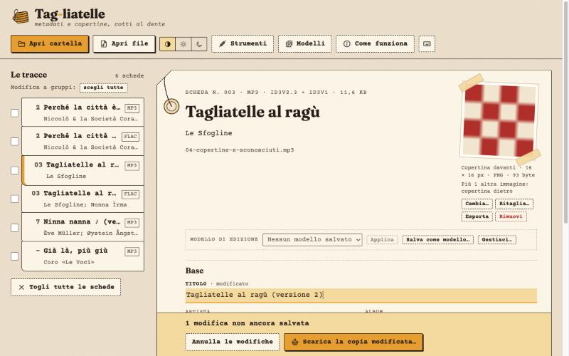
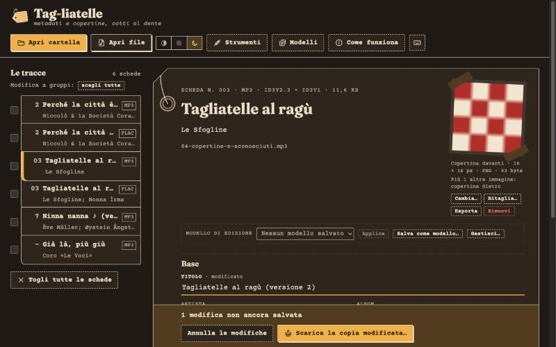

<p align="center"></p>

<p align="center"><em>Metadati e copertine per i tuoi file audio, cotti al dente.</em></p>

**Tag-liatelle** legge e scrive i metadati (i "tag") e la copertina dei file audio **MP3** e **FLAC**: titolo, artista e album, ma anche crediti, copyright, etichetta, licenza e codici. Serve a preparare uscite musicali complete.

Funziona nel browser, sul tuo computer, senza installare niente.

<p align="center"><strong><a href="https://raefsky.github.io/Tag-liatelle/">Provala subito, online</a></strong> · <a href="https://github.com/raefsky/Tag-liatelle/wiki">Leggi la guida</a></p>

---

## Anteprima

Ogni brano è una scheda di collezione. A sinistra la pila delle tracce, al centro la scheda da compilare, con la copertina incollata in un angolo.

<p align="center"></p>

Quando cambi qualcosa, la scheda lo segna e in basso compare il conteggio delle modifiche non ancora salvate. Non si scrive niente finché non lo confermi.

<p align="center"></p>

C'è anche il tema scuro.

<p align="center"></p>

*Le schermate usano i file di prova della cartella `esempi/`.*

---

## Indice

1. [Tutto avviene sul tuo computer](#tutto-avviene-sul-tuo-computer)
2. [Come si apre](#come-si-apre)
3. [Browser compatibili](#browser-compatibili)
4. [Il primo uso, in cinque passi](#il-primo-uso-in-cinque-passi)
5. [La guida completa](#la-guida-completa)
6. [Per chi sviluppa](#per-chi-sviluppa)
7. [Licenza e crediti](#licenza-e-crediti)

---

## Tutto avviene sul tuo computer

- I file vengono letti e modificati nel tuo browser: **non vengono mai caricati su internet**.
- Non servono account né iscrizioni, e non c'è nessuna statistica sul tuo uso.
- Caratteri e programmi sono già dentro la pagina: **funziona anche senza connessione**.
- Nel browser restano soltanto due cose: l'ultima cartella da cui hai aperto i file (per ripartire da lì) e i tuoi modelli di edizione.

**L'audio non viene mai toccato.** Tag-liatelle riscrive solo la parte dei tag e delle immagini. Dopo ogni salvataggio controlla che l'audio sia identico a prima, byte per byte.

## Come si apre

* **Online**: apri <https://raefsky.github.io/Tag-liatelle/> in Chrome o in Edge. È la stessa app: nessun file viene caricato.
* **Sul tuo computer**: fai **doppio clic** sul file `index.html` della versione che usi (per esempio `rilasci/1.0.0/index.html`). È un file unico, che contiene tutto: puoi copiarlo dove vuoi, anche su una chiavetta.

## Browser compatibili

| Browser | Cosa puoi fare |
|---|---|
| **Chrome** 86 o successivo | Tutto: apri intere cartelle e salvi direttamente nei file. Su Windows, Mac, Linux e Chromebook. |
| **Edge** 86 o successivo | Tutto, come Chrome. Su Windows, Mac e Linux. |
| **Safari** e **Firefox** | Un file alla volta: lo apri, lo modifichi e scarichi una copia modificata. L'originale non viene toccato. |
| Telefoni e tablet | L'app è pensata per il computer: sullo schermo piccolo si legge, ma si salva solo scaricando una copia. |

Opera e Vivaldi, basati su Chrome, di solito funzionano, ma non sono stati provati. Brave tiene spenta la funzione che serve per salvare nei file.

## Il primo uso, in cinque passi

1. Fai una **copia** di una cartella di brani (le prime volte è meglio non lavorare sugli originali).
2. Apri `index.html` in Chrome o in Edge e premi **Apri cartella**.
3. Clicca una traccia nella pila a sinistra: a destra compare la sua **scheda**.
4. Cambia un campo, per esempio l'album, e premi **Salva…**. Leggi l'anteprima "prima e dopo" e premi **Scrivi nel file**.
5. Guarda il **timbro "Salvato"** e la cartella `Tag-liatelle copie` comparsa accanto ai brani.

## La guida completa

Tutto il resto è spiegato nella **[wiki](https://github.com/raefsky/Tag-liatelle/wiki)**, una pagina per argomento:

- [Primi passi](https://github.com/raefsky/Tag-liatelle/wiki/Primi-passi)
- [Aprire i file](https://github.com/raefsky/Tag-liatelle/wiki/Aprire-i-file)
- [Modificare e salvare](https://github.com/raefsky/Tag-liatelle/wiki/Modificare-e-salvare)
- [Copie di sicurezza e ripristino](https://github.com/raefsky/Tag-liatelle/wiki/Copie-di-sicurezza-e-ripristino)
- [I campi](https://github.com/raefsky/Tag-liatelle/wiki/I-campi)
- [La copertina](https://github.com/raefsky/Tag-liatelle/wiki/La-copertina)
- [I file FLAC](https://github.com/raefsky/Tag-liatelle/wiki/I-file-FLAC)
- [Modifica a gruppi](https://github.com/raefsky/Tag-liatelle/wiki/Modifica-a-gruppi)
- [Modelli di edizione](https://github.com/raefsky/Tag-liatelle/wiki/Modelli-di-edizione)
- [Strumenti](https://github.com/raefsky/Tag-liatelle/wiki/Strumenti)
- [Scorciatoie da tastiera](https://github.com/raefsky/Tag-liatelle/wiki/Scorciatoie-da-tastiera)
- [Se qualcosa non va](https://github.com/raefsky/Tag-liatelle/wiki/Se-qualcosa-non-va)

---

## Per chi sviluppa

### Struttura del progetto

```
index.html            la pagina (versione di sviluppo: carica css/ e js/)
css/stile.css         aspetto, temi chiaro e scuro
js/                   il programma, senza librerie esterne
  binario.js            lettura di numeri e testi dai byte
  campi.js              i campi, i nomi ID3 e Vorbis, i controlli dei valori
  id3.js, id3-scrittura.js        MP3: lettura e scrittura (ID3v2.2-2.4, ID3v1)
  flac.js, flac-scrittura.js      FLAC: commenti Vorbis, PICTURE, spazio libero
  formati.js            MP3 e FLAC dietro la stessa porta
  immagini.js, ritaglio.js        copertina: misure, ritaglio, JPEG base / PNG
  apertura.js, salvataggio.js     file e cartelle, copie, scrittura sicura, rinomina
  gruppo.js, modelli.js, strumenti.js
  supporto.js, app.js   controllo del browser, interfaccia
font/                 Courier Prime e Fraunces (licenza OFL)
logo/                 logo, bozzetti, icone
esempi/               file MP3 e FLAC di prova piccolissimi (mezzo secondo di silenzio)
test/                 prove automatiche (si aprono anche con un doppio clic su test/index.html)
strumenti/            script: prove, file di prova, file unico, logo
rilasci/<versione>/   il file unico di ogni versione rilasciata
```

### Le prove

- **Nel browser**: apri `test/index.html` con un doppio clic e leggi l'elenco.
- **Dal Terminale**: lo script lancia le prove in Microsoft Edge (o Chrome) senza finestra. Poi controlla con la libreria indipendente **mutagen** sia le letture sia i file scritti da Tag-liatelle, e verifica in Python che l'audio sia identico.

La prima volta prepara l'ambiente con mutagen, dentro il progetto:

```bash
python3 -m venv .venv && .venv/bin/pip install mutagen
```

Poi, ogni volta:

```bash
.venv/bin/python strumenti/prova.py
```

Il file di prova `15-flac-rovinato.flac` è rovinato apposta: mutagen si rifiuta di leggerlo, Tag-liatelle lo segnala.

### I file di prova

Sono costruiti a mano, byte per byte, da `strumenti/genera_esempi.py` (MP3) e `strumenti/genera_flac.py` (FLAC). Non contengono musica vera.

```bash
python3 strumenti/genera_esempi.py
```

### Il file unico

`strumenti/assembla.py` unisce pagina, stile, programma, caratteri e icone in un solo `index.html`, senza nessun collegamento esterno:

```bash
python3 strumenti/assembla.py 1.0.0
```

### Il logo

I file in `logo/` si rigenerano con `strumenti/logo.py`, che richiede `fonttools` per trasformare la scritta in tracciati. I tre bozzetti iniziali sono in `logo/bozzetti.html`.

### Pubblicazione

L'app è pubblicata con GitHub Pages dal ramo `main`, cartella principale: <https://raefsky.github.io/Tag-liatelle/>. Il file `.nojekyll` dice a GitHub di pubblicare i file così come sono. Ogni nuova versione si pubblica inviando le modifiche a `main`:

```bash
git push origin main
```

La cartella `.venv` e i file audio veri non finiscono nel repository (vedi `.gitignore`).

---

## Licenza e crediti

**Tag-liatelle** © Roberto Lanza, rilasciato con licenza [Creative Commons Attribuzione - Non commerciale - Condividi allo stesso modo 4.0 Internazionale (CC BY-NC-SA 4.0)](https://creativecommons.org/licenses/by-nc-sa/4.0/deed.it). Il testo completo è nel file [LICENSE](LICENSE).

- Caratteri: **Courier Prime** (© The Courier Prime Project Authors) e **Fraunces** (© The Fraunces Project Authors), con licenza SIL Open Font License 1.1: vedi `font/OFL-courier-prime.txt` e `font/OFL-fraunces.txt`.
- Nessuna libreria esterna: la lettura e la scrittura dei formati sono scritte da zero e verificate con la libreria indipendente mutagen, usata solo nelle prove.
- MP3, ID3, FLAC, Vorbis, Chrome, Edge, Safari, Firefox e Mac sono nomi e marchi dei rispettivi proprietari.
